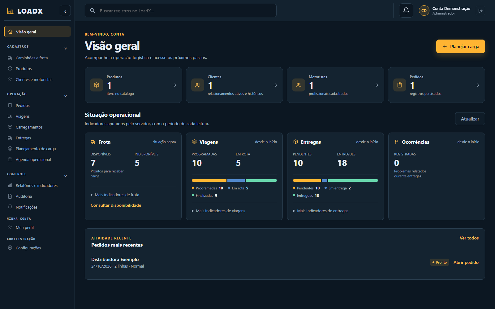
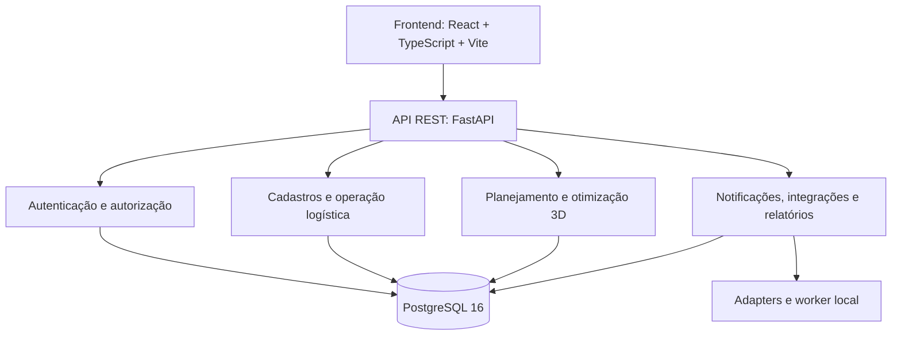

# LoadX Smart Logistics

**Plataforma web para planejamento inteligente de cargas e gerenciamento de operações logísticas.**

O **LoadX Smart Logistics** é um projeto acadêmico de Engenharia de Software que reúne, em um único sistema, o planejamento tridimensional de cargas, a distribuição de volumes entre caminhões e o acompanhamento das etapas de transporte. A proposta é ajudar a organizar o uso da frota e dar mais clareza às operações, desde o cadastro de um pedido até a conclusão de sua entrega.

**Versão oficial:** [v1.2.0 — Evolução Operacional e Multi-Caminhão](https://github.com/RennaN-C/loadx-smart-logistics/releases/tag/v1.2.0) · **Publicada em 26 de outubro de 2026**  
**Estado:** código disponível para execução local, testes e evolução acadêmica. A publicação no GitHub não representa certificação de uma implantação de produção.

[Funcionalidades](#funcionalidades-do-sistema) · [Como funciona](#como-funciona-na-prática) · [Executar localmente](#executar-o-loadx-localmente) · [Arquitetura](#arquitetura-e-tecnologias) · [Testes](#qualidade-testes-e-segurança) · [Documentação](#documentação-e-referências) · [Roadmap](#versões-e-evolução)

---

## Sobre o projeto

No transporte de mercadorias, não basta saber quantos itens devem ser enviados. É preciso considerar o **espaço útil do veículo**, a **massa transportada**, a **ordem de carregamento**, as **restrições de cada produto**, a **disponibilidade da frota** e o andamento das entregas.

O LoadX procura conectar essas necessidades em um fluxo único:

- **Planejar:** cadastrar pedidos e calcular como os volumes podem ser posicionados no baú.
- **Visualizar:** inspecionar a disposição dos itens em uma representação tridimensional.
- **Executar:** conferir o carregamento, organizar viagens e registrar o andamento das entregas.
- **Gerenciar:** acompanhar frota, documentos, usuários, históricos e indicadores.

A aplicação utiliza um **otimizador determinístico**, em vez de depender de IA generativa para decidir se um volume cabe fisicamente em um caminhão. A camada de IA, quando utilizada, serve para apoiar a explicação dos resultados; a validade da carga é definida por regras e cálculos testáveis.

### Interface e experiência de uso

A v1.2.0 reformulou a apresentação do sistema, com identidade visual consistente, menu por áreas, tabelas e formulários reorganizados, melhor tratamento de estados de carregamento/erro e adaptações para diferentes tamanhos de tela. O fluxo de planejamento foi dividido em **Pedidos → Modalidade → Veículos → Revisão** para deixar a sequência mais clara.



*Exemplo visual registrado durante o refinamento da interface da v1.2.0. A imagem é evidência de uma etapa de revisão, não uma certificação de todos os estados da aplicação.*

## Funcionalidades do sistema

### 1. Planejamento de carga e visualização 3D

O planejamento recebe informações sobre produtos, quantidades, dimensões, peso e condições de manuseio. Ao calcular a carga, o backend verifica:

- Limites internos de **largura, altura e comprimento** do caminhão;
- **Peso máximo** e peso acumulado dos volumes posicionados;
- **Rotações permitidas**, colisões e utilização do espaço;
- **Empilhamento, fragilidade e sustentação** dos volumes;
- Ordem de posicionamento e **sequência de carregamento**.

O resultado identifica volumes posicionados ou rejeitados, suas posições e orientações, métricas de ocupação e os motivos pelos quais determinados itens não puderam ser incluídos.

Uma proposta pode ser **analisada antes da aprovação**; planos incompletos não devem ser aprovados como cargas completas. A visualização 3D utiliza os dados calculados no backend — ela não recalcula ou altera as decisões físicas.

### 2. Planejamento e distribuição multi-caminhão

Quando a carga não cabe em um único veículo elegível, o LoadX pode propor uma distribuição entre vários caminhões. A seleção considera a frota disponível e executa as validações físicas em cada parte.

- Distribuição com **identificação individual dos volumes**, evitando perda ou duplicação;
- Seleção automática da quantidade de veículos necessária dentro dos candidatos elegíveis;
- Proposta de distribuição **revisável**, antes de aprovação e execução;
- Acompanhamento por caminhão, com continuidade operacional das partes.

**Limites da v1.2.0:** até **200 volumes físicos totais por planejamento síncrono** e até **10 caminhões candidatos**. Os 200 volumes são o limite **global**, não um limite por caminhão.

**Exemplo:** um pedido com 24 volumes pode utilizar dois caminhões quando o peso, as dimensões e a capacidade da frota exigirem. Se toda a carga couber em um veículo elegível, o sistema não força o uso de dois. O cálculo usa uma heurística com busca limitada, não uma garantia matemática de solução ótima global.

### 3. Cadastros, pedidos e gestão da frota

| Módulo | O que permite fazer |
| --- | --- |
| **Clientes** | Cadastro, múltiplos endereços e escolha do destino, preservando as informações do pedido |
| **Produtos** | Cadastro de dimensões, peso e regras necessárias ao posicionamento dos volumes |
| **Pedidos** | Organização de itens, quantidades, prioridades, destinos, situações e histórico |
| **Caminhões / Frota** | Cadastro, capacidade, disponibilidade e gestão das condições operacionais |
| **Manutenção** | Registro de manutenções e acompanhamento de histórico, datas e quilometragem |
| **Documentação** | Controle de documentos e vencimentos de veículos e motoristas |
| **Motoristas** | Cadastro, CNH, elegibilidade e vínculos com viagens |
| **Importações** | Importação em massa por CSV, sujeita às validações existentes |
| **Arquivamento** | Arquivamento e reativação controlados, preservando histórico quando aplicável |

### 4. Carregamentos, viagens e entregas

Após a aprovação de um planejamento, a operação pode seguir para a conferência dos volumes, finalização do carregamento e organização das viagens.

O sistema acompanha a situação das viagens e entregas, permite registrar ocorrências e possui regras específicas para exceções operacionais, como ausência, recusa, avaria, interrupção e cancelamento elegível.

Em operações multi-caminhão, cada parte possui rastreabilidade própria, sem perder a relação com a necessidade logística original. As transições passam pelas validações do backend; uma ação exibida na interface não ignora automaticamente a situação do pedido, a autorização do usuário ou o vínculo do motorista.

### 5. Administração e segurança da conta

- Administração de **usuários**, perfis e permissões logísticas;
- Configuração dos **dados institucionais da empresa atual**;
- Página de **Meu perfil**, alteração de senha e gerenciamento de sessões;
- Autenticação multifator (**MFA/TOTP**) e dispositivos confiáveis;
- Recuperação de senha por fluxo controlado;
- Histórico e auditoria das ações relevantes.

O sistema aplica autorização no backend e utiliza sessões revogáveis. A administração é interna ao LoadX standalone; ela não representa administração de uma plataforma multiempresa/CoreFlow.

### 6. Acompanhamento, relatórios e integrações

- **Visão Geral:** indicadores e informações relevantes da operação;
- **Agenda operacional:** visualizações diária/semanal dos registros disponíveis;
- **Busca:** filtros por módulo e busca global;
- **Auditoria e linha do tempo:** acompanhamento de fatos e alterações rastreáveis;
- **Relatórios:** consultas gerenciais e documentos operacionais em PDF;
- **Notificações internas:** central de mensagens e preferências;
- **Fila/outbox:** estrutura de eventos, retentativas e reprocessamento;
- **Webhooks e integrações:** contratos de entrada autorizados e painel de saúde;
- **Anexos e evidências:** vínculos com operações e armazenamento privado local.

**Atenção:** o WhatsApp Business real **não está ativo** nesta release. O envio externo por WhatsApp permanece simulado. Integrações externas e armazenamento durável em produção dependem de configuração e validação adicionais.

## Como funciona na prática

O fluxo abaixo representa o percurso principal de uma operação logística:

```text
Clientes, produtos, motoristas e caminhões cadastrados
                         │
                         ▼
                 Criar um pedido
                         │
                         ▼
            Preparar pedido para carga
                         │
                         ▼
        Escolher modalidade de planejamento
                         │
              ┌──────────┴──────────┐
              ▼                     ▼
       Um caminhão           Frota automática
              │                     │
              └──────────┬──────────┘
                         ▼
         Calcular e conferir restrições físicas
                         │
                         ▼
            Revisar plano e visualização 3D
                         │
                         ▼
                  Aprovar a carga
                         │
                         ▼
             Conferir volumes carregados
                         │
                         ▼
              Criar e iniciar viagem
                         │
                         ▼
          Registrar entregas e ocorrências
                         │
                         ▼
          Finalizar operação e consultar relatório
```

**Exemplo de demonstração:** cadastre dois caminhões elegíveis, prepare um pedido que não caiba em apenas um deles e escolha a modalidade automática. Depois do cálculo, confira os veículos selecionados, a distribuição dos volumes e a cena 3D de cada parte. Um cenário local com **24 volumes distribuídos entre dois caminhões** foi registrado nos [ensaios do projeto](docs/evidencias/qa-v12-pentest/planejamento-multi-atividade/README.md).

Para detalhes sobre estados, regras e exceções, consulte o [fluxo operacional](docs/06-fluxo-operacional.md) e as [regras de negócio](docs/04-regras-negocio.md).

## Perfis de acesso

O sistema utiliza papéis operacionais e permissões específicas por recurso. Os quatro perfis-base são:

| Perfil | Responsabilidade principal |
| --- | --- |
| **ADMIN** | Gerenciar a aplicação e executar operações logísticas autorizadas, incluindo cadastros, usuários e configurações |
| **LOGISTICS_MANAGER** | Gerenciar a operação logística, como pedidos, frota, planejamento e viagens, sem administrar credenciais e perfis de terceiros |
| **CHECKER** | Consultar informações necessárias e executar a conferência autorizada de carregamentos |
| **DRIVER** | Consultar e atuar em viagens/entregas próprias, conforme vínculo operacional e transições permitidas |

A v1.2.0 também contém gerenciamento de perfis e permissões logísticas flexíveis. **As permissões efetivas, o vínculo ao objeto e o estado operacional são sempre validados no backend.** O ADMIN não se torna automaticamente motorista nem pode ignorar regras de integridade ou auditoria.

## Arquitetura e tecnologias

O LoadX adota uma arquitetura de **monólito modular**: uma API centraliza os módulos de negócio, mas a responsabilidade de cada domínio permanece separada.



| Camada | Tecnologias |
| --- | --- |
| **Frontend** | React, TypeScript, Vite, React Router, Three.js e React Three Fiber |
| **Backend** | Python 3.12, FastAPI, SQLAlchemy, Pydantic e Alembic |
| **Banco de dados** | PostgreSQL 16 |
| **Testes** | Pytest, Vitest e ensaios de navegador |
| **Qualidade** | Ruff, ESLint, TypeScript, GitHub Actions, SonarCloud e verificações de segurança |
| **Ambientes** | Docker e Docker Compose |

O backend segue a separação **router → service → repository → database**, com algoritmos de domínio e adapters de integrações. O frontend consome contratos REST e apresenta as decisões do backend.

### Estrutura principal do repositório

```text
loadx-smart-logistics/
├── backend/
│   ├── app/
│   │   ├── api/             # Rotas agregadas
│   │   ├── core/            # Configuração e segurança
│   │   ├── database/        # Persistência e sessões
│   │   ├── modules/         # Domínios logísticos
│   │   └── integrations/    # Adapters externos e simulações
│   ├── migrations/          # Migrations Alembic
│   └── tests/               # Testes unitários e de integração
├── frontend/
│   ├── src/
│   │   ├── app/             # Rotas e inicialização
│   │   ├── components/      # Componentes compartilhados
│   │   ├── features/        # Telas por domínio
│   │   └── services/        # Cliente HTTP
│   └── public/              # Assets estáticos e modelos 3D
├── docs/                    # Requisitos, arquitetura, roadmap e evidências
├── infra/                   # Referências operacionais
├── .github/                 # Workflows e templates
├── compose.yaml             # Ambiente de desenvolvimento
├── CHANGELOG.md
└── README.md
```

## Executar o LoadX localmente

### Pré-requisitos

- Git;
- Docker e Docker Compose;
- Portas locais livres ou ajuste das variáveis `POSTGRES_PORT`, `BACKEND_PORT` e `FRONTEND_PORT`.

Para execução **fora** dos contêineres, o projeto documenta Python 3.12, PostgreSQL 16 e Node.js **22.23.1**, conforme `frontend/.nvmrc`.

### 1. Clonar o projeto

```bash
git clone https://github.com/RennaN-C/loadx-smart-logistics.git
cd loadx-smart-logistics
```

Se desejar reproduzir **exatamente a versão lançada**, execute:

```bash
git checkout v1.2.0
```

A tag é um snapshot histórico. Para desenvolvimento, trabalhe em branch própria e não faça commits sobre a tag.

### 2. Configurar o ambiente

No Windows PowerShell:

```powershell
Copy-Item .env.example .env
```

No Linux/macOS:

```bash
cp .env.example .env
```

Abra o arquivo `.env` e defina, no mínimo, **`POSTGRES_PASSWORD`** com senha exclusiva para seu banco local. Confira as demais variáveis conforme a funcionalidade que pretende testar. **Nunca envie `.env`, senhas, tokens ou códigos MFA para o Git.**

### 3. Iniciar os serviços

```bash
docker compose config --quiet
docker compose up -d --build
docker compose ps
```

O Compose executa os serviços na sequência lógica:

1. **db:** sobe o PostgreSQL e aguarda o healthcheck;
2. **migrate:** aplica as migrations do Alembic;
3. **backend:** inicializa a API após a migração;
4. **frontend:** disponibiliza a interface React/Vite.

Se as migrations falharem, o backend pode não iniciar. Leia os logs antes de alterar o banco:

```bash
docker compose logs --tail=100 migrate
docker compose logs --tail=100 backend
```

### 4. Criar o primeiro administrador

Quando o banco ainda não possui usuários, execute o bootstrap interativo:

```bash
docker compose run --rm backend python -m app.modules.auth.bootstrap
```

O comando solicita a senha sem exibi-la no terminal e impede criar outro primeiro administrador se usuários já existirem. Não coloque a senha em scripts, argumentos ou exemplos públicos.

### 5. Abrir a aplicação

| Serviço | Endereço padrão |
| --- | --- |
| **Sistema web** | [http://localhost:5173](http://localhost:5173) |
| **API** | [http://localhost:8000](http://localhost:8000) |
| **Swagger (apenas ambiente local)** | [http://localhost:8000/docs](http://localhost:8000/docs) |
| **Liveness** | [http://localhost:8000/health](http://localhost:8000/health) |
| **Readiness** | [http://localhost:8000/ready](http://localhost:8000/ready) |

O banco utiliza, por padrão, a porta **5433 no host** e 5432 dentro do contêiner. As portas dos serviços locais ficam vinculadas a `127.0.0.1` por padrão.

### 6. Encerrar ou atualizar

```bash
docker compose down
```

**Importante:** `docker compose down -v` exclui os volumes de dados. **Não utilize esse comando para atualizar o projeto ou solucionar erros de migration** em um banco com informações que precisa manter.

Antes de atualizar uma instalação com dados, faça backup coerente do banco e dos anexos privados. Não utilize `alembic stamp` ou downgrade forçado para encobrir revisões ausentes. A revisão Alembic única esperada da v1.2.0 é **`20261023_0035`**.

O procedimento completo, inclusive recuperação de erros e configuração de produção de referência, está em [docs/13-guia-execucao-ambientes.md](docs/13-guia-execucao-ambientes.md).

## Qualidade, testes e segurança

O candidato publicado da v1.2.0 passou por ensaios automatizados e verificações no ambiente de CI.

| Validação no ciclo da v1.2.0 | Resultado registrado |
| --- | --- |
| Testes de backend (Pytest) | **3.001 aprovados** |
| Cobertura local do backend | **95%** |
| Testes de frontend (Vitest) | **1.130 aprovados** |
| ESLint, TypeScript e build | Aprovados |
| PostgreSQL 16 e migrations | Validados em banco isolado |
| Backup e restore locais | Validados com dados fictícios |
| Backend, Frontend, Segurança e SonarCloud no candidato | Checks aprovados |
| Auditoria npm | Nenhum alerta HIGH/CRITICAL; duas ocorrências moderadas em ferramentas de teste |

**Como reproduzir as verificações principais**

Frontend, na pasta `frontend/`, com a versão Node indicada no projeto:

```bash
npm ci --ignore-scripts
npm run lint
npm test -- --run
npm run build
```

Backend, na pasta `backend/`, em ambiente Python 3.12 com PostgreSQL de teste **isolado**:

```bash
python -m pip install --require-hashes -r requirements-dev.lock.txt
python -m ruff check .
python -m ruff format --check .
python -m pytest -q tests --cov=app --cov-report=term
```

**Não rode testes de integração destrutivos apontando para o banco usado pela aplicação.** O arquivo `compose.test.yaml` oferece um ambiente PostgreSQL separado; veja [backend/tests/README.md](backend/tests/README.md) e o [guia de ambientes](docs/13-guia-execucao-ambientes.md).

Os números acima representam os ensaios do **candidato da release**, não métricas dinâmicas nem certificação de produção. A [Issue #268](https://github.com/RennaN-C/loadx-smart-logistics/issues/268) permanece aberta porque a importação da cobertura no SonarCloud não foi comprovada; um Quality Gate verde não equivale a cobertura importada. A [Issue #256](https://github.com/RennaN-C/loadx-smart-logistics/issues/256) acompanha auditorias adicionais.

O sistema utiliza controle de acesso por recursos, sessões revogáveis, validação das transições e trilhas de auditoria. Para relatar uma vulnerabilidade de forma responsável, consulte [SECURITY.md](SECURITY.md).

## Documentação e referências

O README apresenta a visão geral; os detalhes de implementação e regras têm documentos próprios:

| Documento | Conteúdo |
| --- | --- |
| [Índice de documentação](docs/README.md) | Guia de navegação dos documentos atuais e históricos |
| [Visão do produto](docs/00-visao-produto.md) | Motivação, objetivos e usuários |
| [Arquitetura](docs/02-arquitetura.md) | Componentes e responsabilidades |
| [Modelo de dados](docs/03-modelo-dados.md) | Entidades, PostgreSQL e migrations |
| [Regras de negócio](docs/04-regras-negocio.md) | Restrições físicas e regras operacionais |
| [Contratos de API](docs/05-contratos-api.md) | Endpoints, respostas e segurança |
| [Fluxo operacional](docs/06-fluxo-operacional.md) | Etapas da operação logística |
| [Guia de ambientes](docs/13-guia-execucao-ambientes.md) | Execução, testes e diagnóstico |
| [Changelog](CHANGELOG.md) | Histórico das versões oficiais |
| [Roadmap](docs/planejamento/roadmap-versoes.md) | Próximos ciclos propostos |
| [Notas técnicas da v1.2.0](docs/releases/v1.2.0.md) | Compatibilidade, limites e rollback |
| [ADRs](docs/decisions/README.md) | Decisões arquiteturais documentadas |
| [Contribuição](CONTRIBUTING.md) e [AGENTS.md](AGENTS.md) | Regras de colaboração e instruções para agentes de programação |

## Versões e evolução

| Versão | Marco principal |
| --- | --- |
| [**v1.0.0**](https://github.com/RennaN-C/loadx-smart-logistics/releases/tag/v1.0.0) | Primeira versão funcional: cadastros, planejamento 3D e operação-base |
| [**v1.1.0**](https://github.com/RennaN-C/loadx-smart-logistics/releases/tag/v1.1.0) | Maturidade operacional: validações, disponibilidade, RBAC e confiabilidade |
| [**v1.2.0**](https://github.com/RennaN-C/loadx-smart-logistics/releases/tag/v1.2.0) | Multi-caminhão, administração, segurança de conta, frota, comunicação interna e melhorias de interface |

**Direções futuras, não implementadas na v1.2.0:** suporte a cenários maiores que 200 volumes, expansão de escalabilidade, armazenamento externo durável, WhatsApp Business real e, mediante novo planejamento, multiempresa e integração com CoreFlow (v1.3.0 proposta).

A próxima versão exige Issues, critérios de aceite e decisões próprias antes da implementação. Consulte o [roadmap canônico](docs/planejamento/roadmap-versoes.md).

### Organização do desenvolvimento

- **`main`** — código consolidado e manutenção oficial;
- **`desenvolvimento`** — integração de mudanças em andamento;
- **branches de ocorrência** — implementação e correção isoladas por Issue;
- **`versao/vX.Y.Z`** — preparação de uma release, quando necessário;
- **tags `vX.Y.Z`** — snapshots históricos e reproduzíveis.

Fluxo de contribuição: **Issue → branch → testes → PR para desenvolvimento → preparação de release → PR para main → tag e GitHub Release**.

## Equipe e contexto acadêmico

O LoadX é desenvolvido como projeto de Engenharia de Software, articulando atividades de **backend e banco de dados**, **algoritmos de otimização**, **frontend/visualização 3D** e **operações, integrações e qualidade**.

O trabalho envolve especificação de requisitos, versionamento, arquitetura modular, testes automatizados, análise de usabilidade, documentação e evolução incremental por ocorrências (OCs). A divisão histórica e os responsáveis por cada ciclo estão documentados em [docs/07-divisao-equipe.md](docs/07-divisao-equipe.md).

---

**LoadX Smart Logistics v1.2.0** · [Release oficial](https://github.com/RennaN-C/loadx-smart-logistics/releases/tag/v1.2.0) · [Histórico de alterações](CHANGELOG.md) · [Roadmap](docs/planejamento/roadmap-versoes.md)

*O projeto permanece em evolução acadêmica. Funcionalidades de integração real e requisitos de infraestrutura devem ser habilitados e homologados separadamente antes de qualquer uso operacional em produção.*
