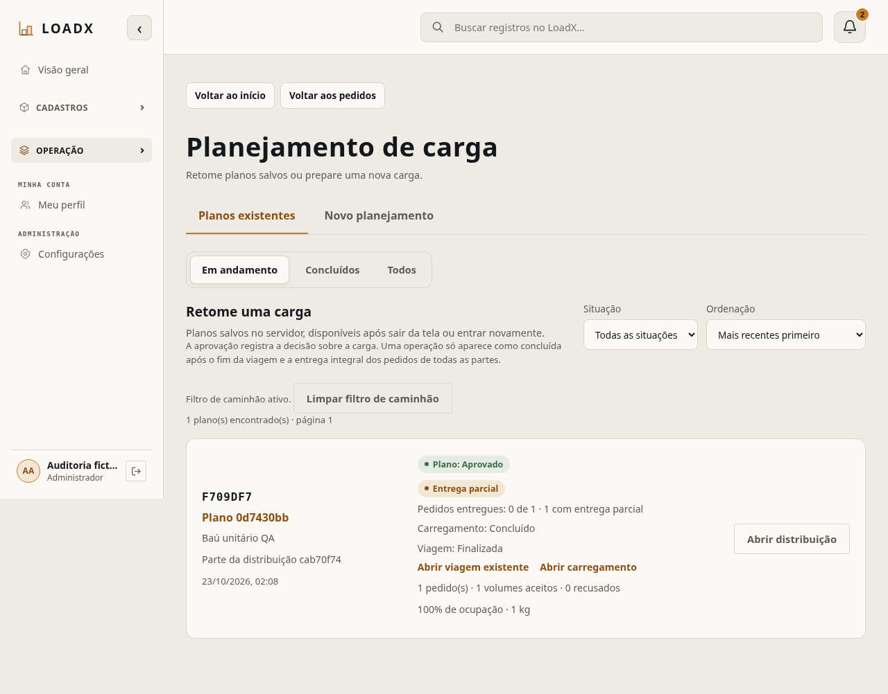
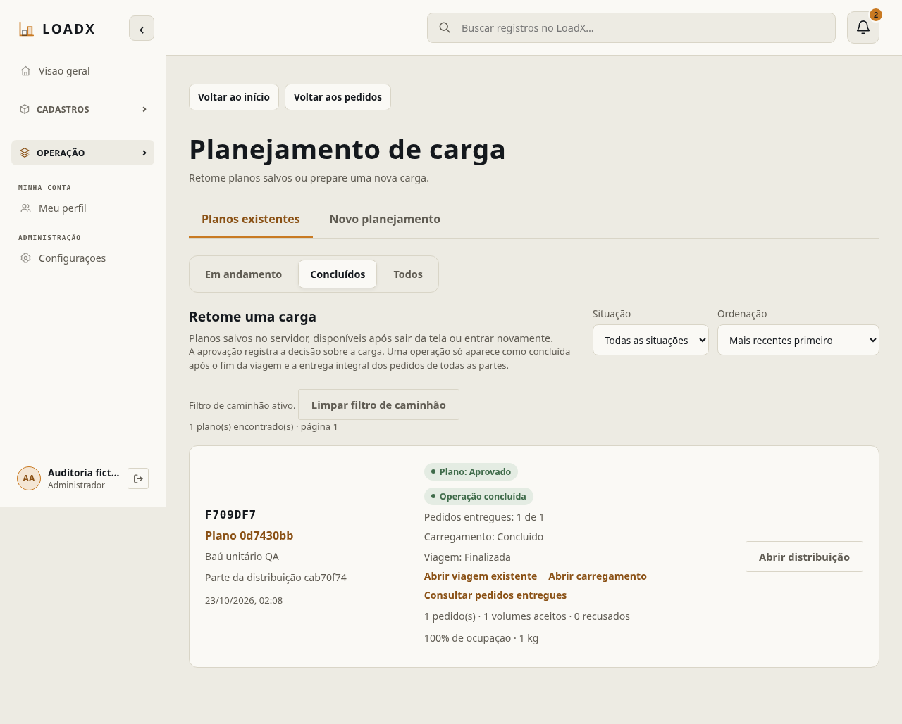
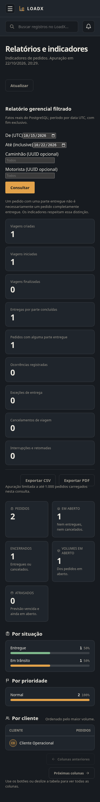
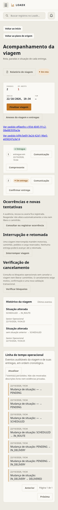
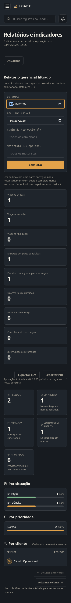
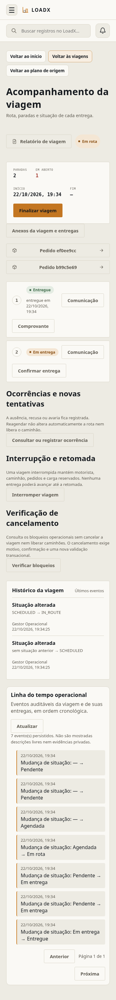

# Auditoria LoadX v1.2.0 — #256

`CONFIRMADO`: execução em 22/10/2026 (America/Sao_Paulo), somente ambientes locais
isolados, dados fictícios, PostgreSQL 16, Python 3.12, Node 22 e Chromium real.
Não houve deploy, reset de pentest compartilhada ou alteração de main/release.
**Auditoria em andamento: esta evidência não aprova integralmente a v1.2.0.**

## Integrações e correções

| ID / severidade | Reprodução / esperado × observado | Correção / evidência |
|---|---|---|
| QA01 / P1 | GET continuidade de viagem INTERRUPTED/CANCELED retornava 500 por enum incompleto; esperado preservar os estados OC94 | PR #264, commit c8c825f; duas reproduções falharam antes, passaram depois em PostgreSQL |
| QA02 / P1 | Repetição de análise de apoio dominava CPU; posição recusada recebia análise completa redundante | PR #262: fe0e2d1/706cd9c; seis regressões físicas diferenciais e benchmark reproduzível |
| QA03 / P2 | Preflight consultava documentos/manutenção por veículo, inclusive arquivados; esperado custo SQL limitado | PR #262: 171c461; regressão com 10→100 arquivados e fronteiras temporais; validação com lock permanece |
| QA04 / P1 | Aprovação de plano confundida com conclusão logística; finalizar uma parte não entrega o pedido inteiro | PR #264: 5663908/1f5a083; resumo SQL, filtros antes da paginação, grants efetivos; fluxo real de duas partes abaixo |
| QA05 / P1 | UI ainda bloqueava distribuição multi-caminhão dizendo depender da OC90 já integrada | PR #264: continuidade real por parte; falha de leitura e aprovação incompleta não liberam criação |
| QA06 / P2 | Relatório gerencial com filtros nativos estreitos e desalinhados | Issue #263: FormField existente, grid responsivo, foco/labels e controles de 44 px; 24 verificações Chromium |
| QA07 / P2 | Viagem exibia UUID inteiro como link azul e não oferecia retorno explícito à lista da gestão | Issue #263: links contextuais com identificação curta, URL íntegra e retorno autorizado; motorista preserva seu início |
| QA08 / P2 | Linha do tempo operacional exibia SCHEDULED/IN_ROUTE/DELIVERED ao usuário | Issue #263: reutiliza rótulos de viagem/entrega, preservando códigos e contratos da API |
| QA09 / P2 | Atalhos de pedidos encostavam no botão de criação no mobile | Issue #263: espaçamento local, filtro real preservado; medida de separação validada no Chromium |

PRs previamente prontas, confirmadas como MERGED no GitHub:
[#258](https://github.com/RennaN-C/loadx-smart-logistics/pull/258), SHA
`3c564913746aa2acef65e93982edf4719763453f`; e
[#260](https://github.com/RennaN-C/loadx-smart-logistics/pull/260), SHA
`5e371beae27be1ef405505e460a9a9582e6ffb4c`.
Novas correções em [#262](https://github.com/RennaN-C/loadx-smart-logistics/pull/262)
e [#264](https://github.com/RennaN-C/loadx-smart-logistics/pull/264) ficam abertas
para revisão. Sem nova migration; head vigente confirmado `20261021_0034`.

Correções UI/evidências na [PR #265](https://github.com/RennaN-C/loadx-smart-logistics/pull/265),
vinculada à Issue #263; permanece aberta para revisão.

## Execuções verificáveis

- Baseline com otimizações de CPU: **2.879 testes backend**, cobertura **94,93%**,
  PostgreSQL 16 exclusivo. Distribuição: 1.433 integration, 1.437 unit, seis E2E
  API/ASGI e três health. Esses E2E existentes não são testes de navegador.
- PR #264, HEAD `80315e7`: CI completa **2.881 backend / 1.048 frontend**, cobertura
  backend aproximadamente **95%**; Ruff, formatação, Alembic, build/TypeScript,
  segurança, contrato e SonarCloud aprovados no GitHub. A execução local adicional
  completa foi interrompida; não foi contada como aprovada no lugar da CI.
- PR #262: **140 testes PostgreSQL focados** passaram. A CI encontrou um teste
  que simulava conflito pelo antigo método individual, deixando de representar
  a consulta em lote. `b20178d` substitui o mock por carregamento persistido e
  confirma a exclusão do veículo ocupado; três regressões focadas passaram.
  CI final no HEAD `b20178d`: 2.881 backend aprovados, cobertura aproximadamente
  95%; Backend/Frontend/Segurança/Contrato/SonarCloud verdes no GitHub.
- Correção UI #263: **1.044 testes Vitest completos**, 75 focados, ESLint e
  TypeScript/build aprovados. Contagens pertencem a branches distintas; não se
  somam como uma suíte única integrada. Cobertura frontend não coletada: o projeto
  não possui @vitest/coverage-v8; não foi adicionada dependência só para o relatório.

### Navegador e HTTP real

`CONFIRMADO`: login pelo navegador, MFA quando exigido, Meu perfil e nove leituras
API por ADMIN, LOGISTICS_MANAGER, CHECKER, DRIVER e CUSTOM. Uma nova autenticação
foi executada após expiração normal da sessão local. Sem alterar a política MFA,
Origin, CSRF ou grants para passar os testes. Resultado sanitizado em
[browser-smoke-results.json](browser-smoke-results.json).

`CONFIRMADO`: fluxo adicional **47 requisições HTTP reais via Vite/API/PostgreSQL**,
com sessões vindas do login real; nenhum mock de resposta ou alteração direta no
banco durante o fluxo. Criou cliente/endereço/produto/dois caminhões/dois motoristas;
arquivou/reativou os quatro cadastros; criou pedido e confirmou snapshot do endereço
após edição; propôs/aprovou distribuição em duas partes; CHECKER conferiu cada
carregamento; gestão criou/iniciou viagens, confirmou entregas e finalizou por etapas.

Após a primeira parte: pedido IN_TRANSIT, plano APPROVED e resumo PARTIALLY_DELIVERED.
Após a segunda: pedido DELIVERED, viagens FINISHED e filtro COMPLETED. Criação
repetida de viagem retornou 409. DRIVER de outro vínculo e CUSTOM sem grant receberam
403. Sair para Produtos, voltar, F5 e reabrir distribuição recuperaram o estado real.
Evidência: [wire-multi-results.json](wire-multi-results.json). O fluxo usou a branch
da PR #264; as correções UI #263 foram verificadas separadamente.

### Visual

`CONFIRMADO`: 26 rotas/seções × 375/768/1280/1920 × claro/escuro = 208 capturas.
Três capturas iniciais em branco foram descartadas/refeitas após reiniciar o
Chromium e aguardar o título. Metadata em [visual-captures.json](visual-captures.json).
Ausência de overflow global não comprova qualidade visual nem funcionalidade.
Houve revisão manual de capturas selecionadas, incluindo módulos recentes;
a revisão manual de toda a matriz e todos os modais ainda não terminou.

`CONFIRMADO`: nas três telas corrigidas, 24 verificações reais adicionais validaram
layout, dimensões dos campos, foco, retorno à lista, rótulos da linha do tempo,
separação entre botões e ausência de erro JS/overflow global.
[visual-ux-regression.json](visual-ux-regression.json).

| Relatório antes / depois | Viagem antes / depois |
|---|---|
|  |  |
|  |  |

## Performance

`CONFIRMADO`: no motor, 200 volumes / dois candidatos equivalentes:
p50 **33,495 → 3,562 s**, p95 nearest-rank (n=3) **35,366 → 3,723 s**.
API ASGI + PostgreSQL 16, fixture equivalente: p50 **42,516 → 5,812 s**;
SQL por amostra **70/74/78 → 67/67/67**. Não é benchmark da rede/Render.
Matriz de 1/2/3/10 candidatos e 10/50/100/200 volumes, três amostras; 14 baselines
físicos concluídos equivalentes; dois censurados em 45 s. Foram executados também
200 volumes exigindo dez veículos selecionados. Dados, recursos, limites e
reprodução estão na [PR #262](https://github.com/RennaN-C/loadx-smart-logistics/pull/262).

## Limites e próximas verificações

`RISCO IDENTIFICADO`: a redução medida não reproduz exatamente os 427 s do Render,
em outro hardware/dataset. Frota heterogênea, orçamento global e recuperação
idempotente da mesma resposta perdida ainda precisam de verificação/contrato na
#254. Claims existentes evitam duplicar distribuição ativa, mas replay 409 não é
uma resposta idempotente com o mesmo recurso.

`PENDENTE DE DEFINIÇÃO` / execução ainda não encerrada:

- E2E de todos os CRUDs/estados em todos os cinco perfis, além do recorte executado.
- Recuperação de senha por Mailjet real, dispositivo confiável/revogação e todos os
  cenários MFA no navegador; integração automatizada existente não substitui isso.
- Renovação documental, manutenção, importação/anexos, notificações/outbox/webhook,
  relatórios/exportação e configurações: regressões backend/frontend da suíte
  executadas; matriz completa de interação visual/E2E ainda pendente.
- Validação de worker OC109 implantado, storage persistente e provedores externos:
  não executada na infraestrutura publicada. WhatsApp continua simulado.
- Revisão manual de todos os modais, contraste e estados de erro/carregamento,
  perfis flexíveis e dispositivos. Não declarar 208 capturas como 208 E2Es.
- Revisão humana e validação conjunta das PRs antes de qualquer merge; nenhum
  deploy foi solicitado/executado.

Nenhum arquivo de sessão, cookie, senha, segredo MFA ou link de recuperação foi
incluído nesta evidência. Credenciais sintéticas do harness ficam fora do Git.
