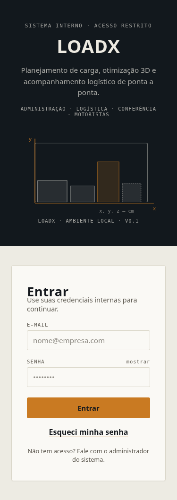
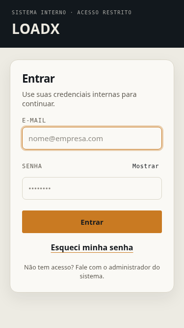
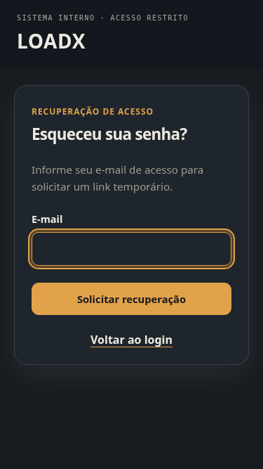

# Delta da auditoria #256 — autenticação e recuperação (#267)

`CONFIRMADO`: base desenvolvimento `3c56491`. Sem dependência das PRs #262/#264/#265
ou #269; nenhum backend, estado, prazo, permissão, credencial compartilhada, segredo
ou política MFA foi alterado. Sem migration ou dependência nova; head `20261021_0034`.

## Defeitos corrigidos

- P1: abrir outro link de recuperação na mesma aba mantinha sucesso/erro anterior
  e ignorava o fragmento novo. Agora o formulário consome o link e remove o fragmento
  imediatamente, mantendo o token somente em memória. Uma resposta atrasada não
  sobrescreve o estado de um link novo; mudança de etapa não reaproveita sucesso.
- P2: em 375×667, o primeiro campo do login começava em y=699 px, abaixo da primeira
  tela. Marca compacta no mobile preserva o formulário e a identidade; após ajuste,
  y=258 px. A ilustração decorativa continua no desktop.
- P2: margem negativa de -10 px sobrepunha descrição e título do login. Agora há
  separação de 8 px, com campos, foco, botões e tipografia coerentes entre acesso,
  recuperação e verificação em duas etapas.
- P2: rodapé fixo dizia AMBIENTE LOCAL/V0.1 em qualquer ambiente. Foi substituído
  pela identificação do produto, sem inventar ambiente ou versão.

## Execuções

`CONFIRMADO`: 83 testes Vitest focados de autenticação (13 arquivos), ESLint e
TypeScript/build aprovados. Inclui novos fragmentos, respostas atrasadas, troca de
etapa, StrictMode e marca sem dados ambientais fictícios. Suíte completa na CI da
PR estabilizada, sem repetição de testes de módulos não alterados.

`CONFIRMADO`: 14 cenários reais de navegador/HTTP/PostgreSQL isolado, registrados
em [autenticacao-cenarios.json](autenticacao-cenarios.json): MFA obrigatório antes
de emitir sessão, anti-replay TOTP, confiança de 30 dias, novo login confiável,
revogação sem encerrar sessão atual, próximo login exigindo segundo fator, código
de recuperação de uso único e incapaz de criar confiança, resposta neutra de
recuperação, SMTP real local, reset com revogação, link consumido, novos links na
mesma aba, rejeição real após reabertura e MFA preservado após reset.

A conta foi criada pela API administrativa com dados fictícios. Senhas foram
alteradas somente pelo fluxo normal sob teste, sem SQL ou bypass. Segredos MFA
foram cadastrados pela interface e preservados. O capturador SMTP Mailpit recebeu
mensagens no ambiente local autorizado; isso **não valida Mailjet**, DNS, entrega
externa ou infraestrutura publicada. A URL local aprovada usa localhost:5173;
não se ampliou a exceção de segurança para outras portas.

`CONFIRMADO`: 26 verificações visuais/teclado no Chromium, quatro larguras e dois
temas, acesso/solicitação/link ausente e desafio LOGIN MFA vazio. Campos acima da
primeira dobra, separação dos textos, mostrar/ocultar senha e ausência de overflow
global. Capturas revisadas; nenhuma captura contém senha, token ou QR/segreto MFA.
[autenticacao-visual.json](autenticacao-visual.json),
[autenticacao-layout.json](autenticacao-layout.json).

| Antes | Depois |
|---|---|
|  |  |

`RISCO IDENTIFICADO`: atualizar/F5 depois de consumir o fragmento remove o token
em memória; solicitar/abrir novamente o link é comportamento intencional, sem
persistência de segredos em Web Storage. A revisão integral dos demais módulos
continua em #256. Importação de cobertura Sonar ainda pendente na #268; check verde
não foi apresentado como comprovação de cobertura nova.
