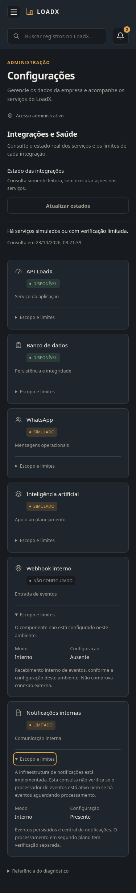
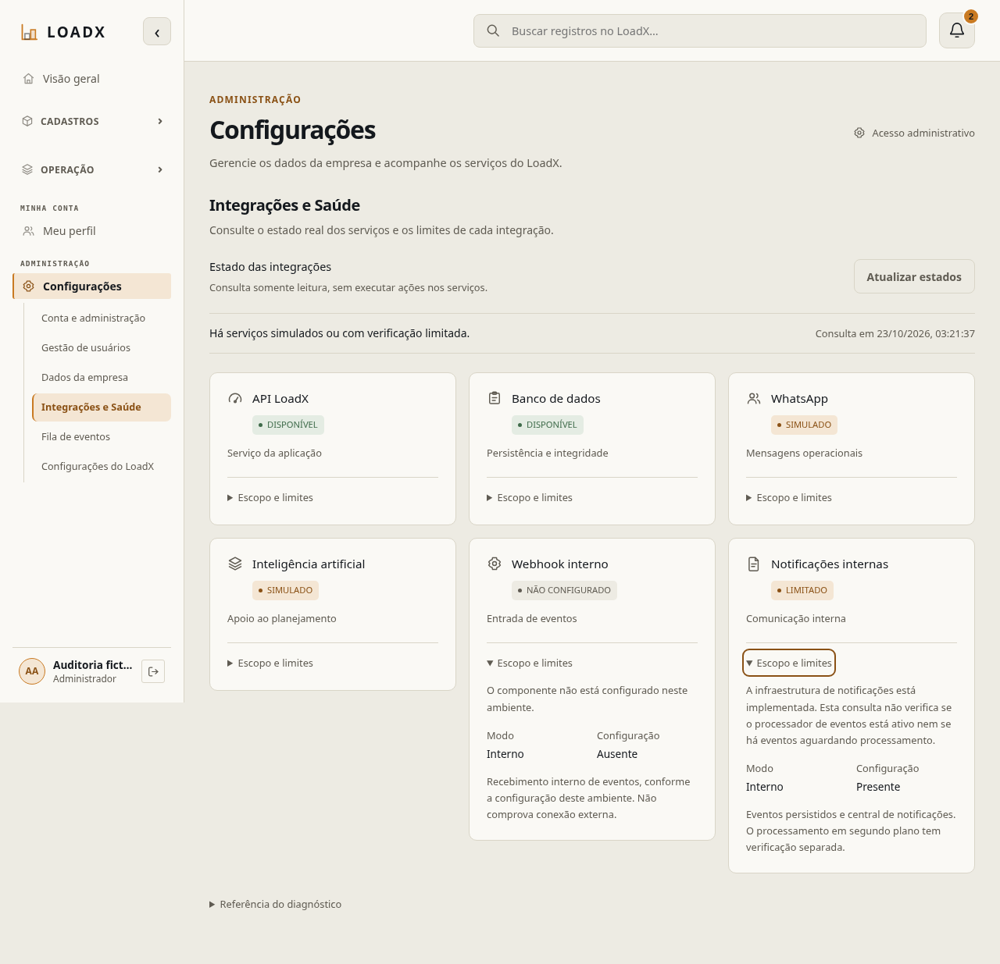

# Delta da auditoria #256 — saúde de integrações (#266)

`CONFIRMADO`: base desenvolvimento `3c56491`; correção independente das PRs
#262/#264/#265, preservadas e ainda em revisão. Sem migration, provider externo,
segredos novos, alteração de permissões ou configuração remota. Head `20261021_0034`.

P2 reproduzido: o painel afirmava OC83/OC84 pendentes apesar da implementação.
O webhook agora lê a presença do runtime existente; desativado é NÃO CONFIGURADO,
inicializado é componente interno disponível. Não certifica entrega externa.
Notificações permanecem LIMITADAS porque esta consulta não observa a saúde do
worker; eventos duráveis, central e fila não são tratados como funcionalidades
inexistentes. WhatsApp continua SIMULADO. Textos técnicos foram esclarecidos em
português, preservando detalhes progressivos e códigos anteriores no catálogo.

`CONFIRMADO`: 42 testes focados unitários/PostgreSQL, 16 Vitest, Ruff/formatação,
ESLint e TypeScript/build aprovados. A suíte completa fica a cargo da CI desta PR
estabilizada, evitando repetir suítes sem alterações relacionadas.

`CONFIRMADO`: Chromium real — oito combinações de largura/tema
(375/768/1280/1920, claro/escuro), teclado nos detalhes e mudança automática com
o sistema; ADMIN autorizado, LOGISTICS_MANAGER/CHECKER/DRIVER/CUSTOM negados na
API e na rota, 401 sem sessão: 14 verificações. Metadados sem credenciais em
[saude-browser.json](saude-browser.json). Capturas revisadas:

`RISCO IDENTIFICADO`: não há prova de envio/recebimento externo, heartbeat do
worker, storage publicado ou saúde ponta a ponta. Estado de configuração não é
certificado de entrega. A constatação de cobertura do Sonar é acompanhada em #268:
check verde com 0% de cobertura nova não substitui os números dos testes.
