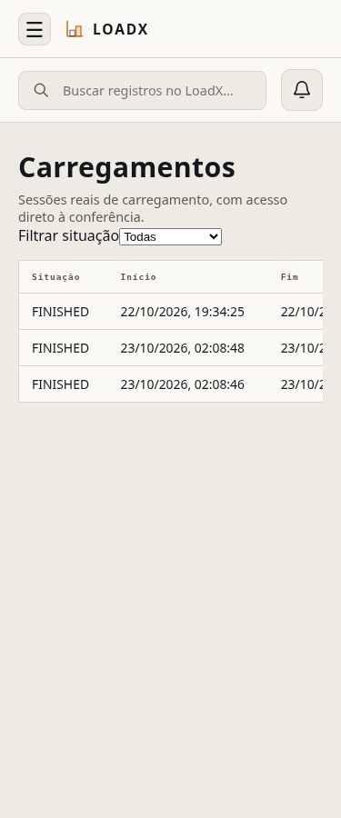
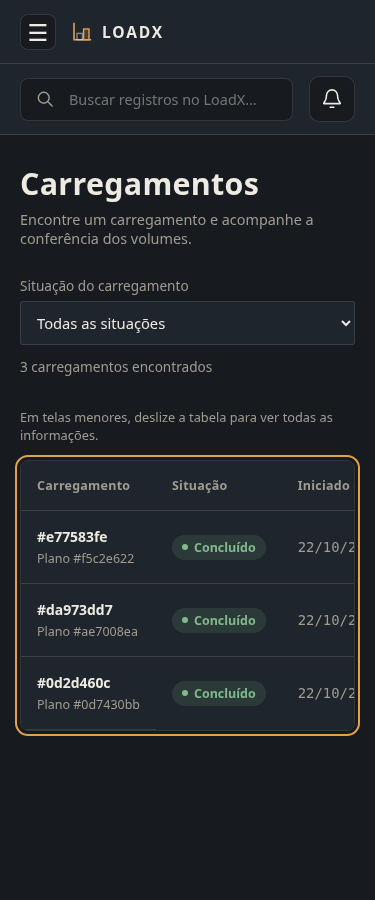
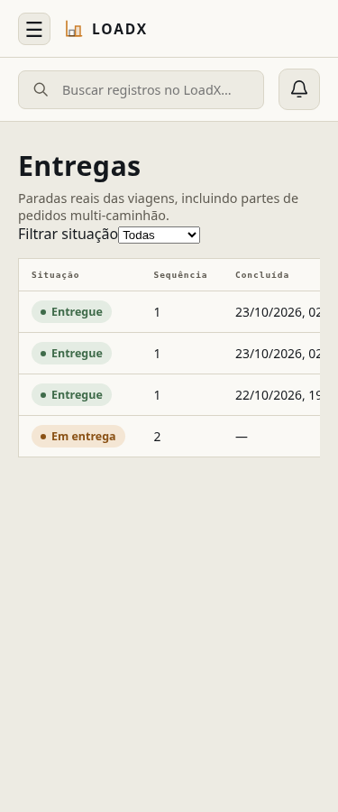
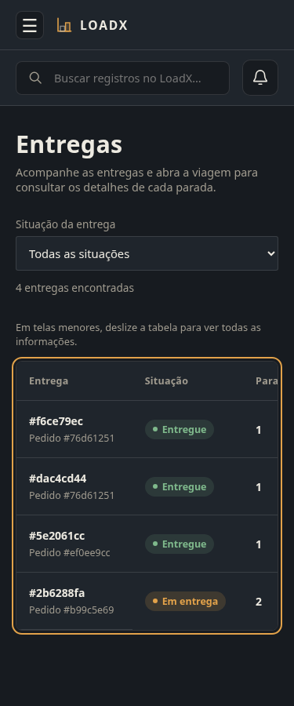
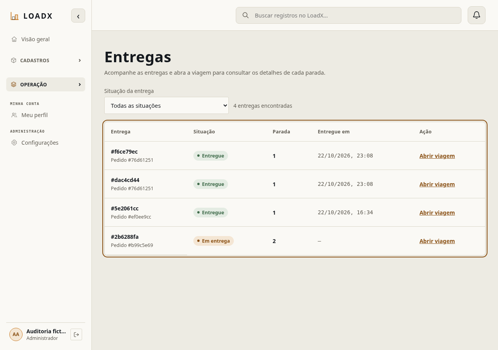

# UI01 — centrais de carregamentos e entregas / #276

`CONFIRMADO`: base `01c39149`; correções funcionais `28f576d`, `5966fa7`,
regressões `4dc5cee`; refinamento final dos rótulos `09add42`.
[Inventário único](ui-inventario.md). Esta aprovação cobre **somente as duas
listagens**, não encerra #256 nem valida todos os detalhes/fluxos dos módulos.

## Defeitos e correções

- Status de carregamento eram códigos internos em inglês. Listagem e detalhe
  agora compartilham os rótulos e tons existentes, sem mudar estados do backend.
- Filtros nativos sem apresentação do produto: FormField existente, labels
  legíveis, largura responsiva e controles com altura mínima de 44 px.
- Registros sem identificação: referências curtas de carregamento/entrega e
  plano/pedido de origem. URLs mantêm UUID completo; não há consulta adicional.
- Ações com nomes repetidos: nomes acessíveis identificam cada recurso.
- Erros de rede/permissão reutilizam tradutores do domínio; vazio filtrado orienta
  selecionar outra situação. Contador representa o total paginado do servidor.
- Tabela com cabeçalhos legíveis, identificação de linha, foco visível e rolagem
  interna descrita no mobile. CSS restrito às duas páginas; sem redesign global.

## Execução real

`CONFIRMADO`: Chromium local, API real na base integrada, PostgreSQL 16 exclusivo
`loadx-qa256-app-pg16` / `loadx_qa_visual`, dados sintéticos anteriores preservados.
Login normal e MFA quando exigido, sem alterar regras, usuários ou credenciais.
Não foram usados mocks de resposta nem integrações externas.

| Perfil | Carregamentos | Entregas |
|---|---|---|
| ADMIN | 200; detalhe, retorno, filtro, F5 | 200; viagem, retorno, filtro, F5 |
| LOGISTICS_MANAGER | 200; detalhe, retorno, filtro, F5 | 200; viagem, retorno, filtro, F5 |
| CHECKER | 200; detalhe, retorno, filtro, F5 | 403, mensagem de acesso negado |
| DRIVER | 403, acesso negado | 200, escopo próprio preservado |
| CUSTOM da fixture (sem grants destes recursos) | 403 | 403 |

`CONFIRMADO`: 16 combinações (duas telas × 375/768/1280/1920 × claro/escuro),
mais dois cenários de tema automático e cinco cenários por perfil: **23 registros**
em [browser-results.json](ui-lote1/browser-results.json). As capturas foram
estabilizadas aguardando o fim da consulta; a região da tabela está focada para
mostrar o anel de teclado. Validados campos ≥44 px, nomes acessíveis, foco/Tab,
Escape, rolagem interna e ausência de overflow da página/erros JavaScript.
Revisão visual antes/depois incluiu as duas telas e os dois temas; capturas
selecionadas abaixo. Demais capturas ficam no artefato local do lote.

A mudança final `09add42` altera apenas tipografia dos filtros: matriz visual
reexecutada; verificações funcionais dos outros quatro perfis de `4dc5cee`
reaproveitadas. Não são novos testes E2E de conferência/transição/OC94.

| Carregamentos antes (375) | Carregamentos depois (375, escuro) |
|---|---|
|  |  |

| Entregas antes (375) | Entregas depois (375, escuro) |
|---|---|
|  |  |

## Regressões e limites

`CONFIRMADO`: 50 testes focados aprovados (incluindo 13 novos casos da central,
conferência e listagem de viagens); **1.083 testes Vitest / 128 arquivos aprovados**
na execução completa. ESLint e TypeScript/build aprovados; orçamento 3D permanece
229,6 KiB gzip ≤250 KiB. Aviso existente de chunk 3D grande permanece, sem nova
dependência. A suíte local emite avisos jsdom de rede de componentes não isolados,
mas não possui falhas; CI executa novamente no HEAD final.

Testes de paginação, loading, erros e retry usam adapters mockados em Vitest,
explicitamente separados da execução Chromium/HTTP real. Não foi criada paginação
falsa no navegador. Não há alteração backend, HTTP, migration, RBAC ou regras
físicas; suíte backend/segurança/Alembic são verificadas pela CI da PR.

`RISCO IDENTIFICADO`: não há medição quantitativa nova de contraste WCAG;
cores/tokens existentes preservados e revisados visualmente nos dois temas.
CUSTOM com grants adicionais e todos os formulários/modais permanecem no inventário.
#268 continua pendente: gate SonarCloud verde não comprova importação de cobertura.
Não houve merge, deploy ou acesso a banco compartilhado.
