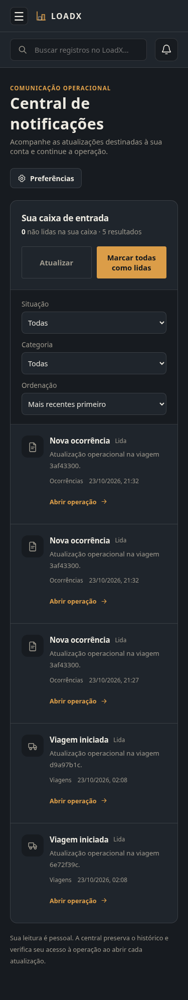
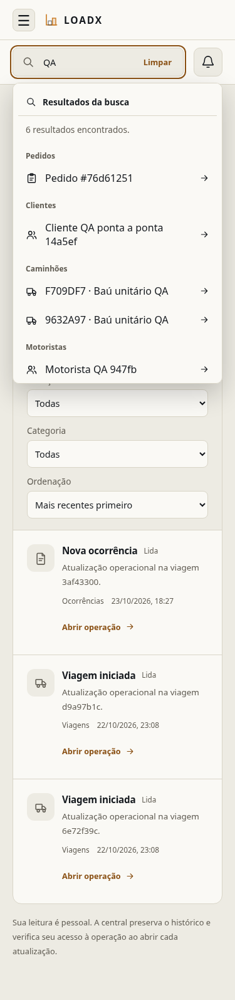
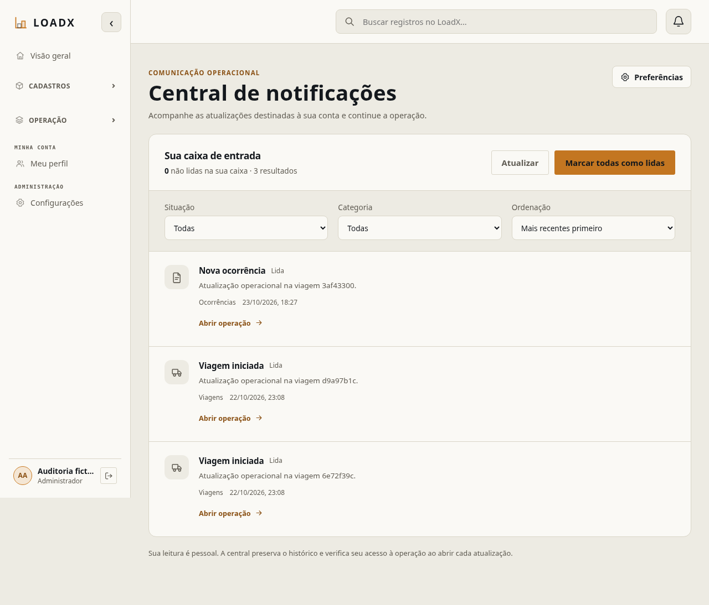
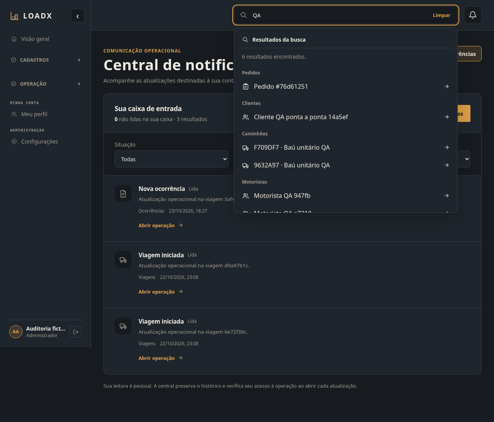
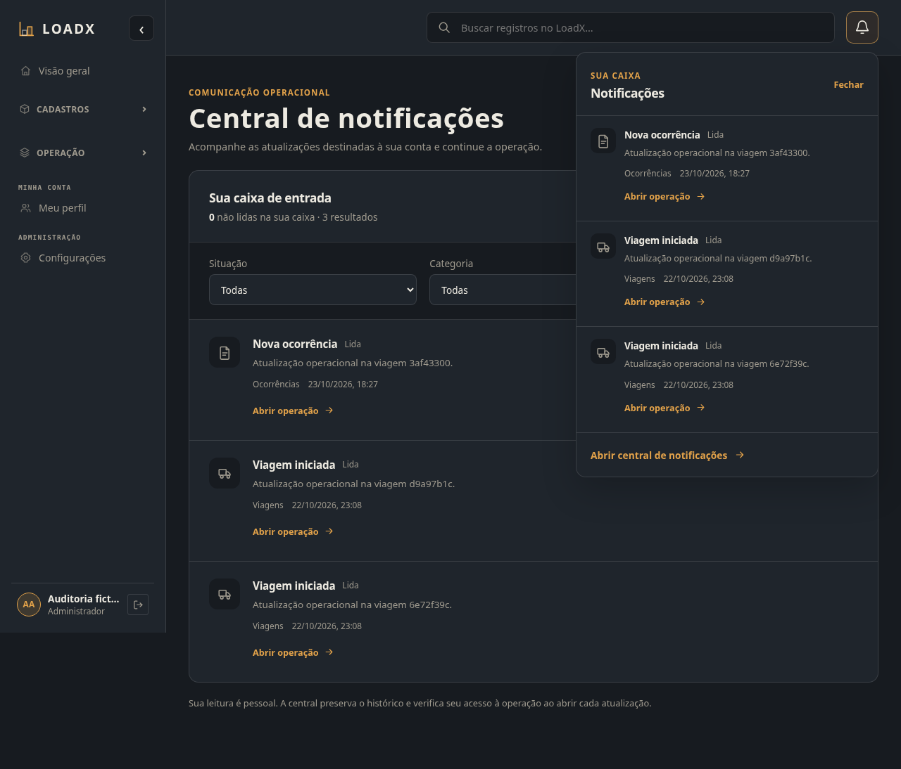

# UI03 — Notificações e Busca global / #285

`CONFIRMADO`: base `f135535346bcb8cc558cbc915815a0da1ba43a1a`. O inventário
existente foi reutilizado; somente suas duas linhas foram atualizadas. UI01
validada e UI02 integrada (#282) preservadas. A PR #283 não foi modificada.

## Alterações verificadas

- `eca00aa`: sino e central descartam ações após fechar/navegar/desmontar,
  incluindo respostas tardias da origem/leitura. Trava imediata evita acionamento
  duplicado; fechar a interface não promete cancelar um commit já feito no servidor.
- Notificações: FormField existente, limpar filtros (com página reiniciada e URL),
  contador explícito sobre a caixa inteira, rótulos de categoria e ações alinhadas
  no mobile. Segurança continua obrigatória, sem fabricar eventos novos.
- `3815f4c` / `ca01609`: busca com painel amplo no mobile, ação Limpar com foco,
  singular/plural naturais, instruções de teclado, referências curtas em pedidos/
  viagens com URL/UUID completo e estados de vazio/falha/permissão distintos.
- `73322a7`: projeção de permissões CUSTOM mantida conforme catálogo. `trips.own`
  é identidade não delegável; não foi criada permissão, vínculo nem regra nova.
  A hipótese inicial sobre CUSTOM foi descartada após consultar o catálogo.

Sem backend, migrations, contratos novos, dependências ou mudanças de MFA/RBAC.
Estilos restritos às duas features, usando tokens e componentes existentes.

## Execução real e limites

`CONFIRMADO`: Chromium com API real e PostgreSQL 16 exclusivo da auditoria,
`loadx_qa_visual` no container local `loadx-qa256-app-pg16`. Dados sintéticos,
login normal/MFA quando exigido; nenhum acesso à pentest ou envio externo.
Duas ocorrências DELAY adicionais geradas pela API oficial serviram como fixture
para leitura individual/em lote. São eventos aprovados existentes, não eventos
de segurança inventados. WhatsApp permanece simulado; nenhum worker externo foi usado.

[Resultado sanitizado](ui-lote3/resultado.json):

- ADMIN, LOGISTICS_MANAGER, CHECKER, DRIVER e CUSTOM: caixa pessoal, categoria/
  situação, limpar recorte, F5; busca com escopo real, resultados ou vazio,
  teclado/Enter, destino existente, limpar e Escape. Vínculo de motorista continua
  decidido pelo servidor. Nenhum perfil recebeu acesso a notificações de terceiros.
- Preferências: cancelar, salvar, persistir após F5 e restaurar valor original;
  Segurança desabilitada para edição. Isso não revalida o restante de Meu perfil.
- Resposta de origem **real** atrasada até fechar o sino: nenhuma navegação ou
  POST de leitura indevido; depois leitura explícita, leitura em lote, contador,
  F5 e replay de read-all com zero atualizações. Injeção de latência sem resposta falsa.
- 375/768/1280/1920 × claro/escuro em central, sino e busca: **24 capturas**,
  limites dos painéis, rolagem, controles e foco. Capturas representativas revisadas
  abaixo; todas as demais ficam no artefato local do lote. Ajuste final de alinhamento
  foi recapturado em 375 nos dois temas; casos inalterados foram reaproveitados.

`CONFIRMADO`: o script inicial concluiu os quatro primeiros perfis e a matriz
visual; no CUSTOM, a asserção contava opções dos filtros como resultados da busca.
O seletor foi restrito ao painel e o CUSTOM reexecutado com sucesso. Essa falha era
no harness e não foi registrada como defeito da aplicação. Resultados aprovados dos
outros perfis foram reutilizados, sem executar novamente a matriz inteira.

## Qualidade

`CONFIRMADO`: **49 testes focados**, **1.103 Vitest completos / 129 arquivos**,
ESLint e TypeScript/build aprovados. Novos casos cobrem descarte de ações tardias,
acionamento repetido, limpar filtros, referências/destinos, plural, foco e RBAC da
busca. Mocks nesses testes são transporte unitário; não substituem o HTTP real acima.

O estado 403 da busca foi coberto por teste de transporte, sem produzir uma falsa
resposta no E2E. A fixture CUSTOM atual recebe vazio autorizado (200). Perfis CUSTOM
com grants delegáveis são adicionalmente cobertos por testes de apresentação.

`RISCO IDENTIFICADO`: não há certificação WCAG integral nem medição nova de todos
os tokens; contraste e foco foram revisados visualmente nos temas existentes.
Cobertura no SonarCloud segue a pendência #268; gate verde não comprova importação.
Backend inalterado: nenhuma suíte backend completa local foi repetida. Checks da PR
registram validação de integração separadamente. Sem merge/deploy.

## Capturas selecionadas

| Central mobile escuro | Busca mobile claro |
|---|---|
|  |  |

## Continuidade

Próximo lote P1: Usuários/perfis e Pedidos, mantendo conferência/OC94 sob o trabalho
já integrado/PR #283. Demais módulos permanecem com seu estado anterior; este lote
não encerra #256 nem valida todas as funções administrativas ou operações logísticas.
