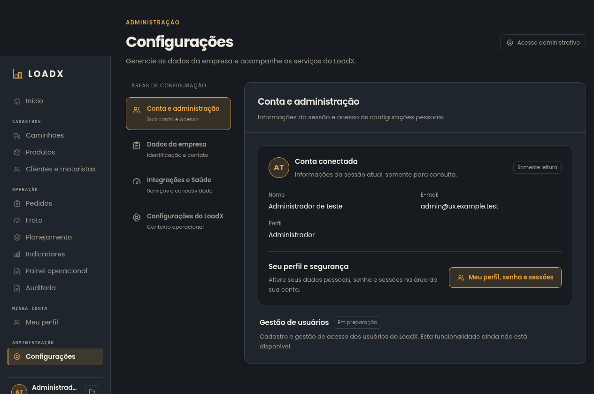
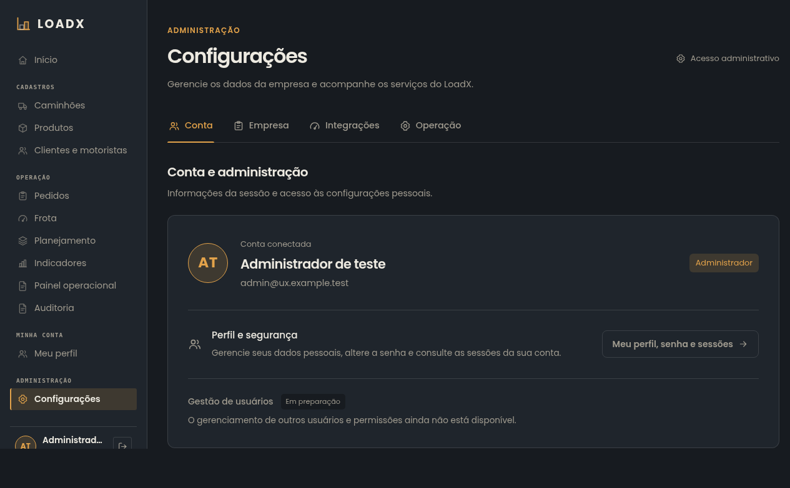
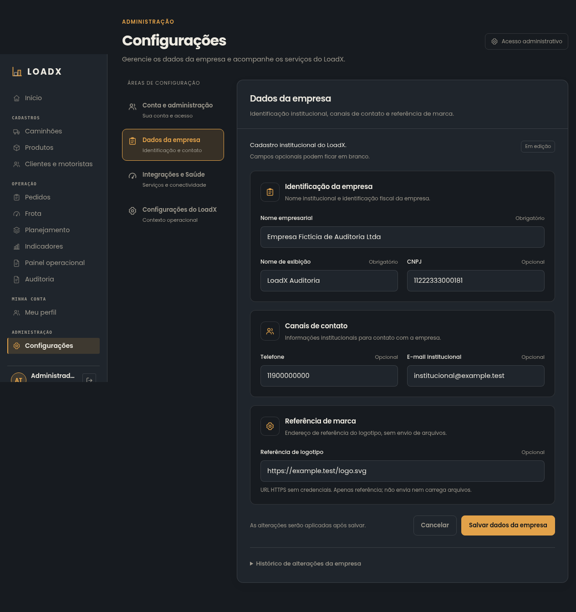
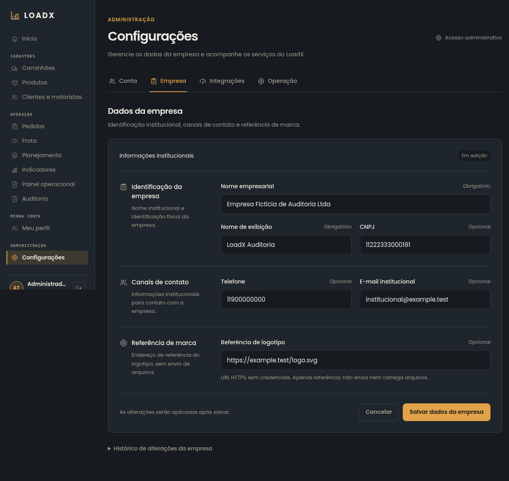
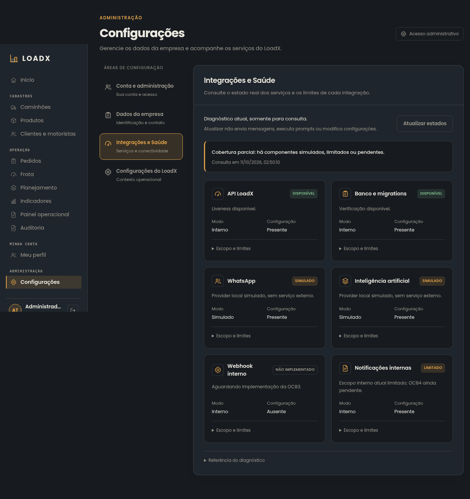
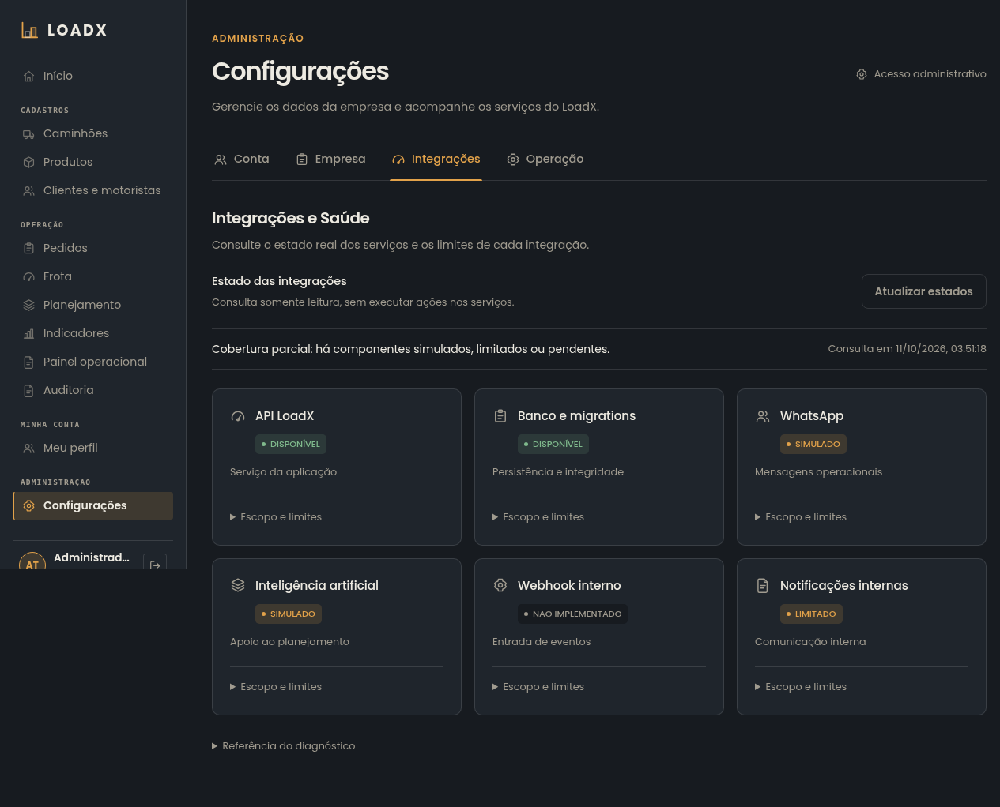
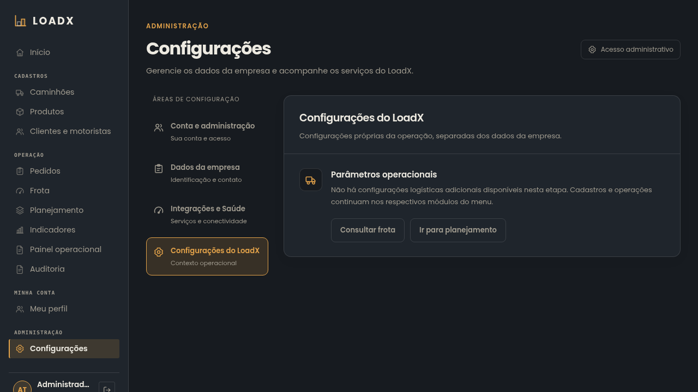
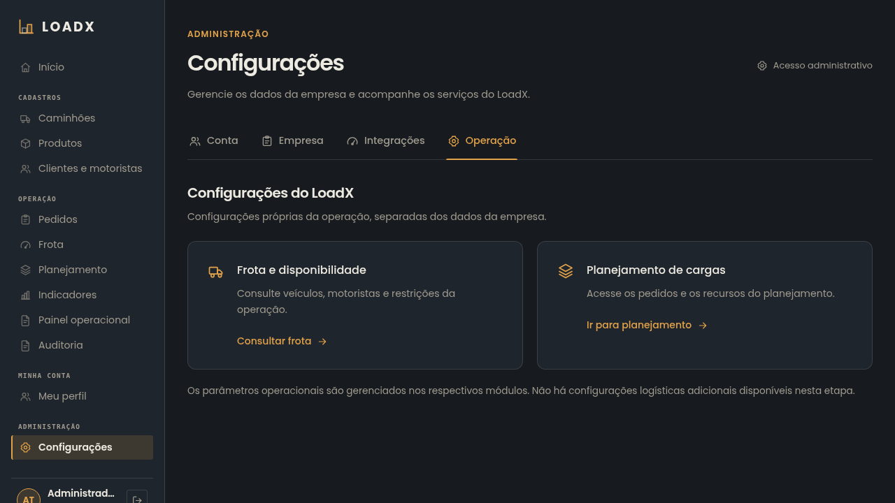

# Configurações — correção visual da PR #201

`CONFIRMADO`: revisão na branch `manutencao/ux-configuracoes-saas-v12`, vinculada
à Issue #200 e PR #201. Capturas com Chromium real, aplicação e PostgreSQL locais,
somente fixtures fictícias de teste. Sem merge ou deploy nesta entrega.

## Decisões e avaliação visual

- Apenas a sidebar principal permanece. Quatro abas horizontais organizam Conta,
  Empresa, Integrações e Operação, com indicador ativo e nomes legíveis no mobile.
- A conta usa uma superfície com identidade e linha de segurança; preparação de
  usuários tem destaque secundário. Nome, e-mail e perfil vêm da sessão real.
- A empresa usa uma superfície de formulário, sem cards internos: grupos com
  divisórias, orientação lateral no desktop, grid e campos de 48 px. Labels de
  14 px e valores de 15 px, estados distintos de edição/consulta e ações no rodapé.
- Saúde usa seis cards independentes compactos, com status textual e cor; o texto
  técnico permanece em detalhes expansíveis. O contêiner da seção não tem borda.
- Operação oferece dois atalhos existentes, sem controles de negócio inventados.
- Grids se adaptam às quatro larguras. SVGs consistentes substituem glifos de seta
  sem suporte na fonte. Hover, foco e preferência por movimento reduzido atendidos.

`CONFIRMADO`: revisadas as quatro seções em 375, 768, 1280×720 e 1920×1080,
claro/escuro. A avaliação incluiu hierarquia, alinhamento, proporção, densidade,
legibilidade, estados e ausência de navegação duplicada/contêineres aninhados;
verificação de overflow não foi usada como único critério de qualidade.

## Comparação antes/depois — notebook, tema escuro

### Conta

| Antes | Depois |
| --- | --- |
|  |  |

### Empresa

| Antes | Depois |
| --- | --- |
|  |  |

### Integrações

| Antes | Depois |
| --- | --- |
|  |  |

### Operação

| Antes | Depois |
| --- | --- |
|  |  |

## Matriz completa de capturas

Abrir cada PNG para inspecionar na resolução original. A imagem é da página
completa; a altura do viewport de notebook foi 720 px e do desktop 1080 px.

| Tema / largura | Conta | Empresa | Integrações | Operação |
| --- | --- | --- | --- | --- |
| Escuro / 375 px | [Conta](after/settings_dark_375_account.png) | [Empresa](after/settings_dark_375_company.png) | [Integrações](after/settings_dark_375_integrations.png) | [Operação](after/settings_dark_375_logistics.png) |
| Escuro / 768 px | [Conta](after/settings_dark_768_account.png) | [Empresa](after/settings_dark_768_company.png) | [Integrações](after/settings_dark_768_integrations.png) | [Operação](after/settings_dark_768_logistics.png) |
| Escuro / 1280 px | [Conta](after/settings_dark_1280_account.png) | [Empresa](after/settings_dark_1280_company.png) | [Integrações](after/settings_dark_1280_integrations.png) | [Operação](after/settings_dark_1280_logistics.png) |
| Escuro / 1920 px | [Conta](after/settings_dark_1920_account.png) | [Empresa](after/settings_dark_1920_company.png) | [Integrações](after/settings_dark_1920_integrations.png) | [Operação](after/settings_dark_1920_logistics.png) |
| Claro / 375 px | [Conta](after/settings_light_375_account.png) | [Empresa](after/settings_light_375_company.png) | [Integrações](after/settings_light_375_integrations.png) | [Operação](after/settings_light_375_logistics.png) |
| Claro / 768 px | [Conta](after/settings_light_768_account.png) | [Empresa](after/settings_light_768_company.png) | [Integrações](after/settings_light_768_integrations.png) | [Operação](after/settings_light_768_logistics.png) |
| Claro / 1280 px | [Conta](after/settings_light_1280_account.png) | [Empresa](after/settings_light_1280_company.png) | [Integrações](after/settings_light_1280_integrations.png) | [Operação](after/settings_light_1280_logistics.png) |
| Claro / 1920 px | [Conta](after/settings_light_1920_account.png) | [Empresa](after/settings_light_1920_company.png) | [Integrações](after/settings_light_1920_integrations.png) | [Operação](after/settings_light_1920_logistics.png) |

## Funcionamento e verificações

`CONFIRMADO`: os contratos HTTP, permissões ADMIN, autenticação e regras de
negócio foram preservados. Fragmentos existentes continuam abrindo as seções;
rascunhos sobrevivem à troca de aba, cancelar restaura a consulta e salvar usa a
API real. Histórico/auditoria e todos os detalhes de saúde continuam disponíveis.

- ESLint, TypeScript/build e orçamento LoadViewer: aprovados.
- Vitest completo: 677 testes em 82 arquivos; 48 testes focados.
- Dois novos testes cobrem os labels das abas e os atalhos operacionais reais.
- Sem nova dependência, contrato HTTP, migration ou mudança de backend.
- Cobertura frontend não instrumentada pela configuração atual.

`PENDENTE DE DEFINIÇÃO`: revisão humana do resultado visual. A aprovação estética
não é inferida exclusivamente dos testes automatizados. Checks remotos do HEAD
final estão publicados na PR #201.
