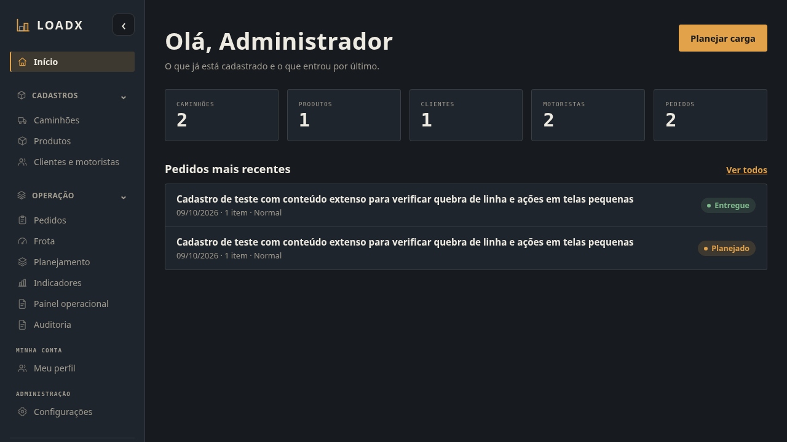
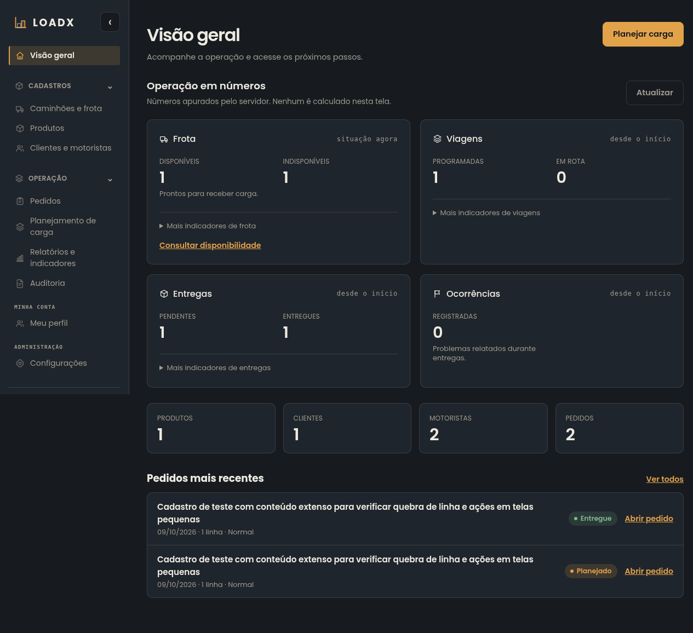
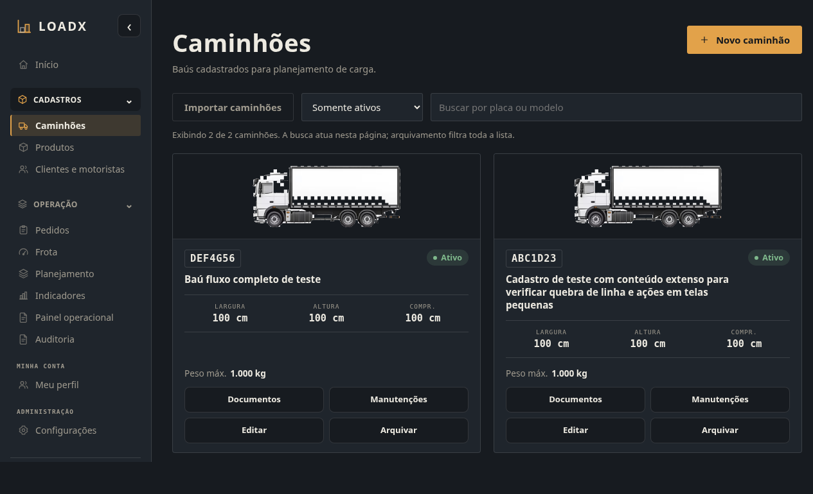
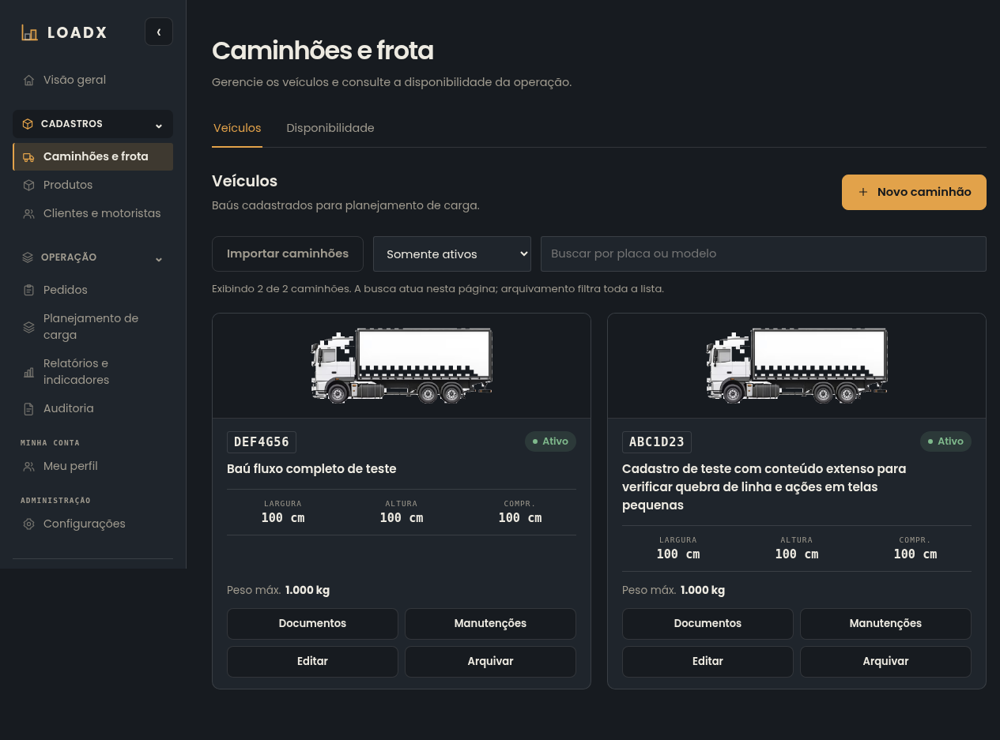
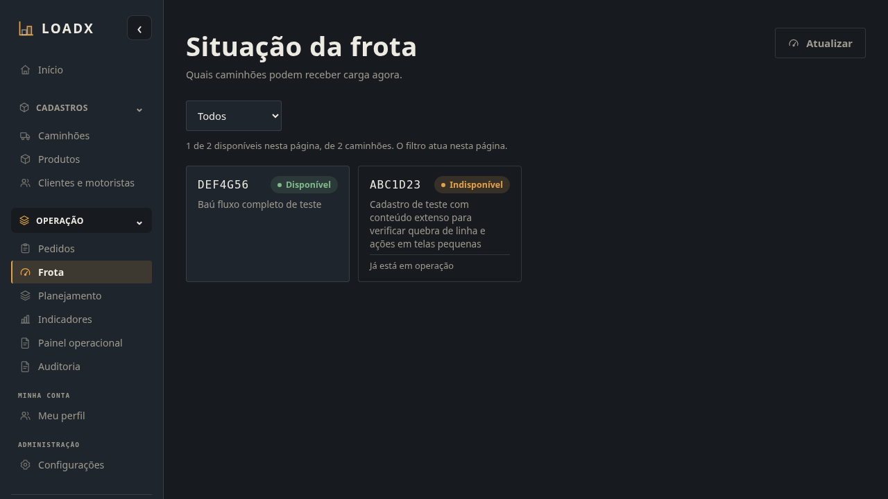
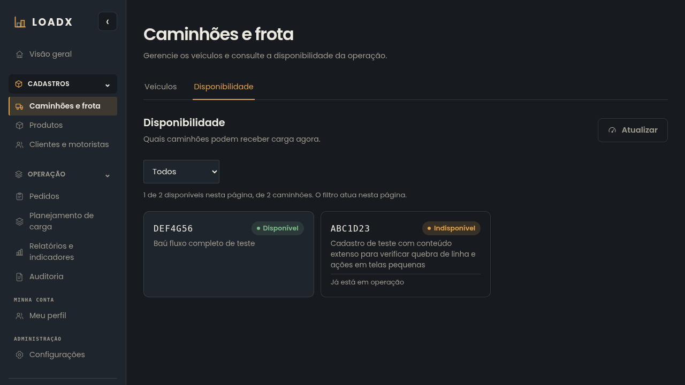
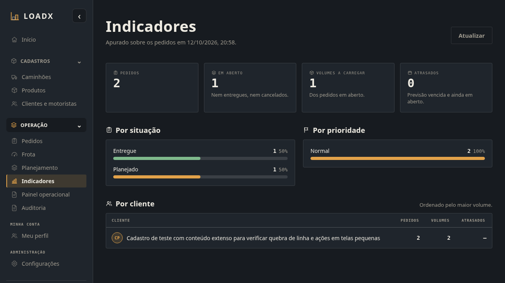
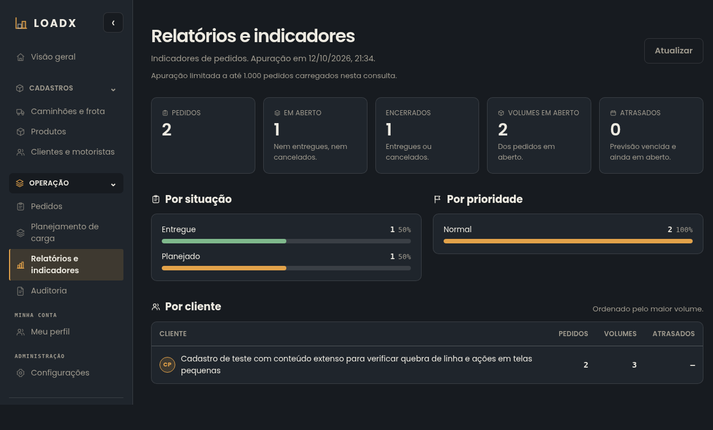

# Consolidação de telas — Issue #206

`CONFIRMADO`: base 3ed8f76, incluindo os merges #201/#203/#205. Branch
`manutencao/ux-consolidacao-paineis-frota-v12`. Capturas reais com Chromium,
frontend/API/PostgreSQL locais e fixtures fictícias; nenhuma gravação de dados
em produção, merge ou deploy nesta entrega.

## O que foi validado

- Visão geral com fontes reais e períodos distintos; pedidos recentes reabríveis,
  falha parcial, retentativa e perfis sem consultas protegidas.
- Caminhões e frota com duas abas, cadastro/edição, documentos, manutenção,
  disponibilidade do backend e filtros/contadores limitados à página carregada.
- Rascunho e rolagem/foco ao usar anterior/próxima com modal de cadastro aberto.
- Relatórios com volumes físicos, limite de 1.000 pedidos, quantidades ausentes
  explicitamente desconhecidas e PDFs existentes preservados.
- Aliases /operations e /fleet nos quatro perfis, acesso direto e navegação real.
- Sidebar única, acordeões, gaveta mobile e submenus da base preservados.

`CONFIRMADO`: revisadas 32 combinações finais (4 telas × 4 larguras × 2 temas).
A avaliação incluiu densidade, hierarquia, alinhamento, campos, conteúdo extenso,
foco/contraste e rolagem, além de overflow. Na revisão, uma tabela móvel que
comprimia nomes foi corrigida com largura mínima, controles nativos de rolagem, regiões
nomeadas e instrução explícita. Os controles aparecem apenas quando há overflow
e permitem acesso por teclado/toque às colunas, respeitando os limites. Os textos não são reduzidos a uma letra por linha.

## Antes/depois — notebook, tema escuro

### Visão geral

| Antes | Depois |
| --- | --- |
|  |  |

### Caminhões

| Antes | Depois |
| --- | --- |
|  |  |

### Disponibilidade

| Antes | Depois |
| --- | --- |
|  |  |

### Relatórios

| Antes | Depois |
| --- | --- |
|  |  |

Painel operacional separado antes da consolidação: [captura anterior](before/ux206_dark_1280_operations.png).

## Matriz completa

PNGs da página inteira; viewport notebook 1280×720 e desktop 1920×1080.

| Tema / largura | Visão geral | Veículos | Disponibilidade | Relatórios |
| --- | --- | --- | --- | --- |
| Escuro / 375 px | [Visão geral](after/ux206_dark_375_overview.png) | [Veículos](after/ux206_dark_375_trucks.png) | [Disponibilidade](after/ux206_dark_375_availability.png) | [Relatórios](after/ux206_dark_375_reports.png) |
| Escuro / 768 px | [Visão geral](after/ux206_dark_768_overview.png) | [Veículos](after/ux206_dark_768_trucks.png) | [Disponibilidade](after/ux206_dark_768_availability.png) | [Relatórios](after/ux206_dark_768_reports.png) |
| Escuro / 1280 px | [Visão geral](after/ux206_dark_1280_overview.png) | [Veículos](after/ux206_dark_1280_trucks.png) | [Disponibilidade](after/ux206_dark_1280_availability.png) | [Relatórios](after/ux206_dark_1280_reports.png) |
| Escuro / 1920 px | [Visão geral](after/ux206_dark_1920_overview.png) | [Veículos](after/ux206_dark_1920_trucks.png) | [Disponibilidade](after/ux206_dark_1920_availability.png) | [Relatórios](after/ux206_dark_1920_reports.png) |
| Claro / 375 px | [Visão geral](after/ux206_light_375_overview.png) | [Veículos](after/ux206_light_375_trucks.png) | [Disponibilidade](after/ux206_light_375_availability.png) | [Relatórios](after/ux206_light_375_reports.png) |
| Claro / 768 px | [Visão geral](after/ux206_light_768_overview.png) | [Veículos](after/ux206_light_768_trucks.png) | [Disponibilidade](after/ux206_light_768_availability.png) | [Relatórios](after/ux206_light_768_reports.png) |
| Claro / 1280 px | [Visão geral](after/ux206_light_1280_overview.png) | [Veículos](after/ux206_light_1280_trucks.png) | [Disponibilidade](after/ux206_light_1280_availability.png) | [Relatórios](after/ux206_light_1280_reports.png) |
| Claro / 1920 px | [Visão geral](after/ux206_light_1920_overview.png) | [Veículos](after/ux206_light_1920_trucks.png) | [Disponibilidade](after/ux206_light_1920_availability.png) | [Relatórios](after/ux206_light_1920_reports.png) |

## Qualidade, limites e integração

`CONFIRMADO`: ESLint, TypeScript, build e Vitest completo locais aprovados:
721 testes em 85 arquivos. As validações remotas de Backend, Frontend, Segurança,
Contrato e SonarCloud ficam registradas no PR. Sem mudança de contrato HTTP,
dependência ou migration. Cobertura frontend não instrumentada pela suíte atual.

`CONFIRMADO`: o resultado do navegador verificou ADMIN, LOGISTICS_MANAGER,
CHECKER e DRIVER; consultas globais/pessoais negadas não foram disparadas pelos
dois últimos. Cenários 503 e coleção vazia foram interceptações controladas
somente no navegador de teste; as capturas da matriz usam a API real.

`PENDENTE DE DEFINIÇÃO`: a central de viagens/entregas OC93 permanece fora desta
manutenção. Não existe nesta base destino geral para cada métrica; nenhum link
foi inventado. Viagens do motorista e operações vinculadas mantêm seus detalhes.

`RISCO IDENTIFICADO`: OC86 também modifica AppLayout/testes de Configurações;
reconciliar rótulos/links ao integrar a branch do Marlon, sem sobrescrever gestão
de usuários. Arquivos da OC81/evidências não foram alterados.

`CONFIRMADO`: aprovação visual humana e merge/deploy não são automatizados nesta entrega.
